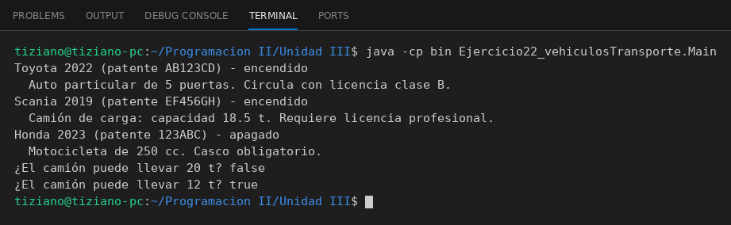

# Vehiculo

Programación II - Unidad 3 - Ejercicio 22

## Consigna
Modelar una jerarquía de clases con herencia: una clase base y subclases que reutilizan código con `super` y sobrescriben métodos. Una flota con autos, camiones y motos.

## Lógica
- `Vehiculo` guarda patente, marca y año, y tiene `encender()` y `apagar()`.
- `AutoParticular`, `Camion` y `Motocicleta` usan `super(...)` y agregan su atributo (puertas, capacidad de carga, cilindrada).
- Cada una reescribe `mostrarInformacion()`.
- `Main` recorre la flota de forma polimórfica.

## Ejecución

